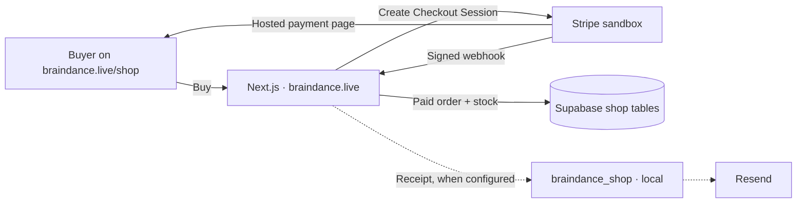
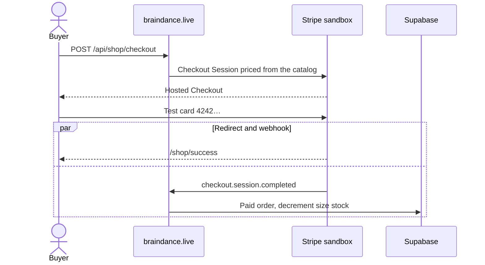

# Braindance (frontend)

Next.js app for **Braindance** at [https://braindance.live](https://braindance.live): DJ set discovery, stream pages, listener profiles, and the merch shop.

## What we're building right now

The current build is **merch checkout on the real domain, still in the Stripe sandbox**. A buyer can go through Checkout at `https://braindance.live/shop`. The test card `4242 4242 4242 4242` completes a payment. A real card is declined, so this phase does not take live money.

The charge path lives in this Next.js app. `braindance_shop` is a small FastAPI service that sends order email through Resend. It is still local, so a paid order is saved even when the receipt email is skipped.



The success page does not create the order. Stripe calls `POST https://braindance.live/api/shop/webhook`, the signature is checked, and the order is written only when `payment_status` is paid.



| Now, on braindance.live | After this path is proven |
| --- | --- |
| Sandbox keys (`sk_test_` / `pk_test_`, or a restricted `rk_test_`) | Live restricted key (`rk_live_`) |
| Dashboard webhook `https://braindance.live/api/shop/webhook` | Same path, with the live endpoint’s signing secret |
| Orders stored in Supabase | Receipt and ship emails once `braindance_shop` is on HTTPS |

Local development still uses `http://localhost:3000` plus the Stripe CLI. That CLI signing secret only verifies events forwarded to your machine. The domain webhook needs its own `whsec_…` from the sandbox Dashboard.

## Stack

- **Next.js 15** (App Router), **React 19**, **TypeScript**
- **Tailwind CSS** + shared glass styles in `src/app/globals.css` (`glass-bends`, `glass-bends-card`, motion helpers like `ease-bends`)
- **Supabase** (client) for hosted events, streams table, links, heatmap/geo, feedback/contact tables
- **Optional HTTP backend** proxied via `BACKEND_URL` (DJ sets list, per-video metadata, pipeline `GET /streams/...`)

## Getting started

```bash
npm install
npm run dev
```

Open [http://localhost:3000](http://localhost:3000).

```bash
npm run build   # production build
npm run lint
npm test        # Jest
```

---

## Environment variables

| Variable | Purpose |
|----------|---------|
| `NEXT_PUBLIC_SUPABASE_URL` | Supabase project URL |
| `NEXT_PUBLIC_SUPABASE_ANON_KEY` | Supabase anon key (browser) |
| `JWT_SECRET` | App auth JWT (`auth_token` cookie; `/profile` + `/api/auth/token`) |
| `BACKEND_URL` | Origin of the **external** API (e.g. `http://localhost:3000` or `https://api.example.com`). Used by `/api/dj-sets` and `/api/streams/*`. Trailing paths like `/dj-sets` are normalized away. |
| `BACKEND_URL_BACKUP` | Optional second origin; used when primary fails or returns empty for DJ sets |
| `STREAM_UI_MOCKS` | Set to `1` / `true` / `yes` so **`/api/streams/:id`** and **`/api/streams/:id/tracks`** return **mock JSON** (no backend). Good for UI work. |
| `NEXT_PUBLIC_SITE_URL` | Public origin. Hosted app: `https://braindance.live`. Local checkout redirects: `http://localhost:3000`. Set it once. YouTube embed `origin` uses the browser host (see `src/app/lib/utils/youtube.ts`). |
| `NEXT_PUBLIC_YOUTUBE_EMBED_HOST` | Set to `nocookie` to use `youtube-nocookie.com` embeds |
| `NEXT_PUBLIC_TWITCH_PARENT` | Hostname Twitch allows for embeds. `localhost` locally, `braindance.live` on the hosted site. Defaults to `localhost` if unset. |
| `NEXT_PUBLIC_UMAMI_WEBSITE_ID` | Umami website UUID (public). When set, loads the analytics script site-wide. |
| `NEXT_PUBLIC_UMAMI_SCRIPT_URL` | Optional. Defaults to `https://analytics.hoochymoochy.xyz/script.js`. |
| `SUPABASE_SERVICE_ROLE_KEY` | Supabase service role secret key (server-side only) used for listener analytics aggregation, archetype caching, vault progress writes, and shop admin/webhook DB writes. |
| `STRIPE_SECRET_KEY` | Stripe **test** secret key (`sk_test_…` or restricted `rk_test_…`) from the Braindance sandbox. |
| `STRIPE_WEBHOOK_SECRET` | Webhook signing secret (`whsec_…`). Local CLI secret and the `https://braindance.live/api/shop/webhook` endpoint secret are different. |
| `NEXT_PUBLIC_STRIPE_PUBLISHABLE_KEY` | Sandbox publishable key (`pk_test_…`). |
| `SHOP_BACKEND_URL` | Origin of **braindance_shop** (e.g. `http://localhost:8001`). Server-only — order emails. |
| `SHOP_SERVICE_SECRET` | Shared secret matching `braindance_shop` `SHOP_SERVICE_SECRET`. Server-only. Never put `RESEND_API_KEY` in the frontend. |

### Shop / Stripe local test

1. Put sandbox keys in `.env` (Dashboard → Braindance sandbox → Developers → API keys).
2. Forward Checkout webhooks (newer CLI requires `--events` or `--all-snapshot`):
   ```bash
   npx @stripe/cli listen --events checkout.session.completed,checkout.session.async_payment_succeeded,checkout.session.async_payment_failed --forward-to localhost:3000/api/shop/webhook
   ```
   Copy the `whsec_…` into `STRIPE_WEBHOOK_SECRET`.
3. Restart `npm run dev`, open `/shop`, checkout with test card `4242 4242 4242 4242`.
4. Confirm the order under `/admin/orders` (login as `Khaydenroberts22@gmail.com`).

### Shop / Stripe on braindance.live

Sandbox only. The hosted app uses `https://braindance.live` for Checkout success and cancel URLs.

1. Set the host env: `NEXT_PUBLIC_SITE_URL=https://braindance.live`, sandbox `STRIPE_SECRET_KEY`, sandbox `NEXT_PUBLIC_STRIPE_PUBLISHABLE_KEY`, and `SUPABASE_SERVICE_ROLE_KEY`. Leave `SHOP_BACKEND_URL` unset until the email service has a public HTTPS URL.
2. In the Braindance sandbox, add a webhook endpoint `https://braindance.live/api/shop/webhook` for `checkout.session.completed`, `checkout.session.async_payment_succeeded`, and `checkout.session.async_payment_failed`.
3. Put that endpoint’s signing secret in `STRIPE_WEBHOOK_SECRET` and redeploy.
4. Buy from `https://braindance.live/shop` with `4242 4242 4242 4242`. Confirm the order in `/admin/orders` and in the sandbox Payments list.

Copy from your hoster / Supabase dashboard; there is no committed `.env` in-repo.

---

## App routes (pages)

All live under `src/app/`. Global **Header** + **Footer** + padded `<main>` come from `src/app/layout.tsx`.

| Route | What it does |
|-------|----------------|
| `/` | Home: hero, then DJ set grid (“Random set”, featured + paginated sets from **`GET /api/dj-sets`**). **`/events`** redirects here. |
| `/stream/[eventId]` | Public stream viewer. **`eventId`** interpretation below. Tracklist can save **moments**; cards can add sets to **crates**. |
| `/stream/[eventId]/photo-upload` | Photo upload for a legacy hosted event |
| `/policy`, `/feedback`, `/contact` | Static-ish content + forms writing to Supabase utilities |
| `/shop`, `/shop/[slug]`, `/shop/success` | Merch catalog + Stripe Checkout + post-pay page |
| `/admin`, `/admin/products`, `/admin/orders` | Merch admin (allowlisted email) |
| `/login` | Login / sign-up (Supabase + JWT cookie) → `/profile` |
| `/profile` | Your profile: edit, share, crates + moments (JWT-protected) |
| `/profile/crates/[crateId]` | Own crate (Spotify-style playlist view) |
| `/u/[username]` | **Public shareable profile** (includes vault flex shelf) |
| `/u/[username]/crates/[crateId]` | Public crate view |

### Weekly Vault

One hand-picked exclusive YouTube set per week. Users fill a shared meter to **100** (resets Monday 00:00 UTC). Unlocks are flex-only on profiles — strangers still need their own unlock to play.

| Action | Points |
|--------|--------|
| Listen (per 10 min real playback) | +5 |
| Save a track (like) | +5 (unlike removes it this week; re-like only counts next week) |
| Finish a set | +10 |
| Discover a new DJ | +15 |
| New calendar day this week (UTC) | +5 |

Set this week’s exclusive on the **backend** (ingests like `/dj-sets/add`, then upserts `vault_weeks`):

```bash
curl -X POST http://localhost:8000/vault/weeks \
  -H "Content-Type: application/json" \
  -d '{"url":"https://www.youtube.com/watch?v=XXXX"}'
```

Frontend also proxies the same call at `POST /api/vault/weeks`. Progress/unlock routes stay on Next: `GET /api/vault/me`, `POST /api/vault/events`, `GET /api/vault/week`, `GET /api/vault/access?videoId=`, `GET /api/vault/unlocks?userId=`.

---

## How `/stream/[eventId]` picks a source

`eventId` is a **string** from the URL.

1. **UUID** (RFC shape)  
   - Try **pipeline**: `GET /api/streams/:id` → if `200` and body has `youtube_url`, treat as Braindance pipeline stream.  
   - Then `GET /api/streams/:id/tracks` for the sidebar tracklist.  
   - Embeds use `buildYoutubeEmbedSrc()` in `src/app/lib/utils/youtube.ts`.  
   - If that fails or no `youtube_url`, fall through.

2. **Supabase event**  
   - `getStreams(eventId)`, `getLinks`, `getEventById`, optional views + city for UUIDs.  
   - Stats + **GlobeHeatmap** when it’s a DB event (`isDbEvent`).

3. **YouTube video id** (11 chars, common fallback)  
   - `POST /api/dj-sets` with `{ "videoId": eventId }` → proxies to backend `GET /dj-sets/:videoId`.

**Globe:** `GlobeHeatmap` is loaded with **`next/dynamic({ ssr: false })`** from the stream page so `react-globe.gl` never runs on the server (`window` / WebGL).

### Profiles / crates / moments / listener archetypes

Run `supabase/migrations/001_profiles_crates_moments.sql`, then `002_profile_on_signup_trigger.sql`, `003_public_profile_read.sql`, and `20261007011500_listener_archetypes.sql` in the Supabase SQL editor. Tables: `profiles`, `crates`, `crate_sets`, `moments`, `listener_archetypes`, `listening_sessions`.

---

## Next.js API routes (proxies)

Implemented in `src/app/api/`. They call **`BACKEND_URL`** (and optional backup) except when mocks are on for streams.

| App route | Upstream (typical) | Notes |
|-----------|--------------------|--------|
| `GET /api/dj-sets` | `GET {BACKEND_URL}/dj-sets` | Shapes `featured`, `currentSets`, filters by duration in route |
| `POST /api/dj-sets` | `GET {BACKEND_URL}/dj-sets/:videoId` | Body: `{ "videoId": "..." }` |
| `GET /api/streams/[id]` | `GET {BACKEND_URL}/streams/:id` | Mock if `STREAM_UI_MOCKS` |
| `GET /api/streams/[id]/tracks` | `GET {BACKEND_URL}/streams/:id/tracks` | Response may normalize to `{ tracks: [...] }` |
| `GET /api/listener-profile` | Local rule-based classifier | Listening style + header stats (`?userId=...`, `?force=true`) |

Shared fetch helpers: `src/app/lib/backend/http.ts`.

---

## Example JSON shapes

**Pipeline stream** (from your Braindance API / mocks):

```json
{
  "id": "a0eebc99-9c0b-4ef8-bb6d-6bb9bd380a11",
  "title": "Example set",
  "artist": "DJ Name",
  "youtube_url": "https://www.youtube.com/watch?v=jfKfPfyJRdk",
  "soundcloud_url": null,
  "duration": 3600,
  "thumbnail": "https://i.ytimg.com/vi/.../maxresdefault.jpg",
  "created_at": "2026-04-01T12:00:00.000Z",
  "backendSource": "mock"
}
```

**Tracks** (array or wrapped):

```json
{
  "tracks": [
    {
      "id": "t-001",
      "stream_id": "a0eebc99-9c0b-4ef8-bb6d-6bb9bd380a11",
      "timestamp": "00:04:12",
      "artist": "Artist",
      "title": "Track title",
      "spotify_url": "https://open.spotify.com/track/...",
      "soundcloud_url": null
    }
  ],
  "backendSource": "primary"
}
```

**DJ set card** (from `/api/dj-sets`, simplified):

```json
{
  "video_id": "abc123def45",
  "title": "Set title",
  "channel": "Channel name",
  "published_at": "2026-01-01T00:00:00.000Z",
  "thumbnail": "https://i.ytimg.com/...",
  "url": "https://www.youtube.com/watch?v=...",
  "view_count": 120000,
  "duration_seconds": 3600
}
```

---

## UI dev without the pipeline API

```bash
STREAM_UI_MOCKS=1 npm run dev
```

Open **`/stream/a0eebc99-9c0b-4ef8-bb6d-6bb9bd380a11`** (preset in `src/app/lib/mocks/streamFixtures.ts`) or any UUID for default mock data. See comments in that file for preset IDs.

---

## Notable directories

| Path | Role |
|------|------|
| `src/app/` | App Router pages, layouts, API routes |
| `src/app/components/` | UI (Header, Footer, StreamCard, GlobeHeatmap, …) |
| `src/app/lib/` | Supabase helpers, backend HTTP, events, mocks |
| `src/components/` | Shared (e.g. `ColorBends`) |
| `_archive/` | Old/unused snippets kept for reference |

---

## Troubleshooting

- **`window is not defined` / globe / Three:** ensure globe imports stay **dynamic `ssr: false`** (see stream + host stream pages).  
- **Backend `fetch failed`:** see logs from API routes; test `BACKEND_URL` with `curl` from the same machine as Next.  
- **YouTube embed blocked:** set `NEXT_PUBLIC_SITE_URL`; optional `NEXT_PUBLIC_YOUTUBE_EMBED_HOST=nocookie`. Some videos disallow embedding (owner setting), which no code can override.

---

## Agent / AI helper

See **[AGENTS.md](./AGENTS.md)** for a quick map of where features live and conventions used in this repo.
